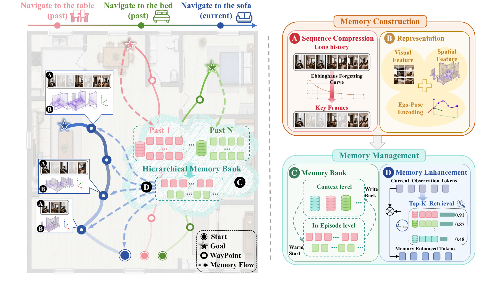

# MemoryVLN

**From Ego-Aware Memory Representation to Cross-Context Memory Reuse in Vision-Language Navigation**

[**Project Page**](https://zgca-hmi-lab.github.io/MemVLN/) · [Code Guide](CODE.md) · [Videos](https://zgca-hmi-lab.github.io/MemVLN/#videos)

  

MemoryVLN is a memory-driven system for long-horizon vision-language navigation. It turns an accumulating stream of first-person RGB observations into compact, spatially grounded experience that can be retrieved within an episode and reused across related episodes.

> **Project page:** <https://zgca-hmi-lab.github.io/MemVLN/>

## Overview

MemoryVLN is organized around two stages:

- **Memory construction** uses Long Sequence Compression to retain dense recent evidence and representative distant observations under a fixed token budget. It then combines 2D appearance, 3D geometry, and 6D ego pose into spatially grounded memory tokens.
- **Memory management** maintains short- and long-term in-episode memory alongside a persistent context-level bank. It warm-starts new episodes with relevant context, writes back only confident experience, and retrieves Top-*K* memories to enhance the current observation.

This design avoids repeatedly encoding the full navigation history while preserving the historical and spatial evidence needed for action prediction.

## Results

Results from the paper on the VLN-CE val-unseen splits. MemoryVLN uses a single RGB stream and standard VLN training trajectories, without DAgger rollouts or additional navigation data.

| Benchmark | NE ↓ | OS ↑ | SR ↑ | SPL ↑ | nDTW ↑ |
| --- | ---: | ---: | ---: | ---: | ---: |
| R2R-CE | **3.52** | **59.98** | **54.76** | **50.26** | — |
| RxR-CE | **3.33** | — | **57.84** | **50.42** | **63.52** |

Compared with the data-comparable JanusVLN baseline, MemoryVLN improves success rate by about 2.0 points on R2R-CE and 6.5 points on RxR-CE.

## Repository layout

~~~text
.
├── README.md            this file (project overview and links)
├── CODE.md              evaluation guide: environment, data, and closed-loop testing
├── config/              Habitat VLN-CE configurations (R2R-CE, RxR-CE)
├── scripts/             evaluation launchers
├── src/                 model, memory, and evaluation implementation
├── requirements.txt     Python dependencies
├── setup.py             package metadata
└── site/                project webpage (deployed to GitHub Pages)
~~~

## Getting started

This repository releases the **evaluation code only**. See [CODE.md](CODE.md) for the complete guide, including environment setup, model and data preparation, and closed-loop evaluation.

~~~bash
git clone https://github.com/ZGCA-HMI-Lab/MemVLN.git
cd MemVLN

conda create -n memvln python=3.9 -y
conda activate memvln

# Habitat-Sim 0.2.4 (headless)
conda install habitat-sim==0.2.4 headless -c conda-forge -c aihabitat

pip install torch==2.6.0 torchvision==0.21.0 torchaudio==2.6.0 \
  --index-url https://download.pytorch.org/whl/cu124
pip install -r requirements.txt
pip install -e .
~~~

Evaluation commands, together with the reference configuration and the reproducibility checklist, are documented in [CODE.md](CODE.md).

## Webpage

The project page under [`site/`](site/) is a static site published to GitHub Pages by [`.github/workflows/pages.yml`](.github/workflows/pages.yml):

- Live: <https://zgca-hmi-lab.github.io/MemVLN/>
- Local preview: `cd site && python3 -m http.server 8123`

## BibTeX

~~~bibtex
@article{memoryvln2027,
  title={MemoryVLN: From Ego-Aware Memory Representation to Cross-Context Memory Reuse in Vision-Language Navigation},
  author={Anonymous Submission},
  journal={arXiv preprint},
  year={2027}
}
~~~

## License

This code package is released under the Apache-2.0 license. See [LICENSE_APACHE-2.0.txt](LICENSE_APACHE-2.0.txt). The VGGT-derived components are covered by [LICENSE_VGGT.txt](LICENSE_VGGT.txt); see [THIRD_PARTY_NOTICES.md](THIRD_PARTY_NOTICES.md) for details.
